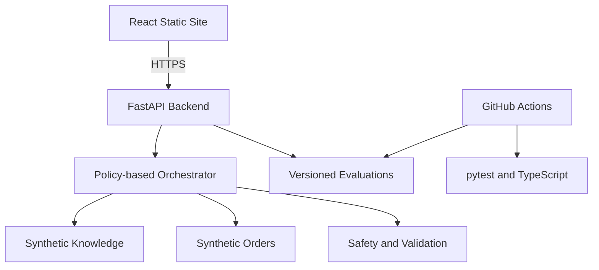

# Agentic Reliability Lab

**A spec-driven engineering reference implementation for inspectable agent-style workflows.**

[](https://github.com/sc-aisuperjack/agentic-reliability-lab/actions/workflows/ci.yml)

> **Transparent mode:** This project starts with a deterministic policy engine, **not an LLM-powered autonomous agent**. It executes actual Python routing, tenant-scoped synthetic retrieval, order lookup and safety checks. It does not use external model keys, real customer data or proprietary Vozara/Centrica code.

## Included

- React + TypeScript interface: customer scenarios, agent execution trace, synthetic tenant selection, evaluation results and requirements.
- FastAPI backend with typed contracts and inspectable tool decisions.
- Versioned 14-case behavioural evaluation suite and pytest.
- SDD documents: intent, specification, implementation plan and architectural decision.
- GitHub Actions quality gates, plus Render Blueprint with free-tier resource requests.

## Architecture



## Run locally

Requires **Python 3.14** and Node.js 22+. Python 3.14.10 is pinned in `backend/.python-version` for CI and Render. Any installed Python 3.14.x interpreter can be used locally.

### Windows / VS Code (PowerShell)

From the repository root:

```powershell
cd backend
py -3.14 --version
py -3.14 -m venv .venv
.\.venv\Scripts\python.exe -m pip install -r requirements-dev.txt
.\.venv\Scripts\python.exe -m pytest -q
.\.venv\Scripts\python.exe -m uvicorn app.main:app --reload --port 8010
```

If `backend/.venv` already exists from Python 3.12, **delete that old virtual environment first** (`Remove-Item -Recurse -Force .venv` while inside `backend`, with any running interpreter stopped) and recreate it with `py -3.14 -m venv .venv`. VS Code: **Python: Select Interpreter** → `backend\\.venv\\Scripts\\python.exe`.

### Linux / macOS

```bash
cd backend
python3.14 -m venv .venv
source .venv/bin/activate
python -m pip install -r requirements-dev.txt
python -m pytest -q
python -m uvicorn app.main:app --reload --port 8010
```

API docs at http://localhost:8010/docs; GET `/health` returns the actual `python_version`.

### React frontend (second terminal, repository root)

```bash
cd frontend
npm install
npm run dev
```

Open http://localhost:5173. The frontend uses `VITE_API_URL` if set; otherwise it calls `http://localhost:8010`. See `frontend/.env.example`.

Open http://localhost:5173. The frontend uses VITE_API_URL if set; otherwise it calls localhost:8010. See frontend/.env.example.

## Render deployment

The `render.yaml` Blueprint manages two services in the `Agentic Reliability Lab / Production` Render project: a free Python 3.14 Web Service and a static React site. Inspect pricing before applying subsequent infrastructure changes. The free backend sleeps when idle, leading to a cold-start delay.

If Render assigns different service URLs, update VITE_API_URL in the static site's build settings and CORS_ORIGINS in the backend service to match. Both frontend and backend must be reachable.

## Spec-driven engineering

- [Intent](intent/reliable-support/intent.md): Why.
- [Specification](intent/reliable-support/spec.md): What and acceptance criteria.
- [Plan](intent/reliable-support/plan.md): How and proof.
- [ADR](docs/adr/001-deterministic-baseline.md): Architecture trade-offs.
- [Evaluation source](backend/app/evaluations.py): Executable behavioural cases.

## Limitations

Fictional businesses and records only. The public tenant selector is not real authentication. Known-phrase safety rules do not solve general prompt injection. Document identifiers are verified against selected knowledge but not semantically scored. No real handoffs or LLM calls occur.

## Next development milestone

Add an optional LLM reasoning adapter behind controlled tools with budgets, prompt-injection evaluations and accurate trace/usage reporting. Default public mode remains free.

## Copyright

No open-source licence has been granted yet; source is public for review, not unrestricted reuse.
